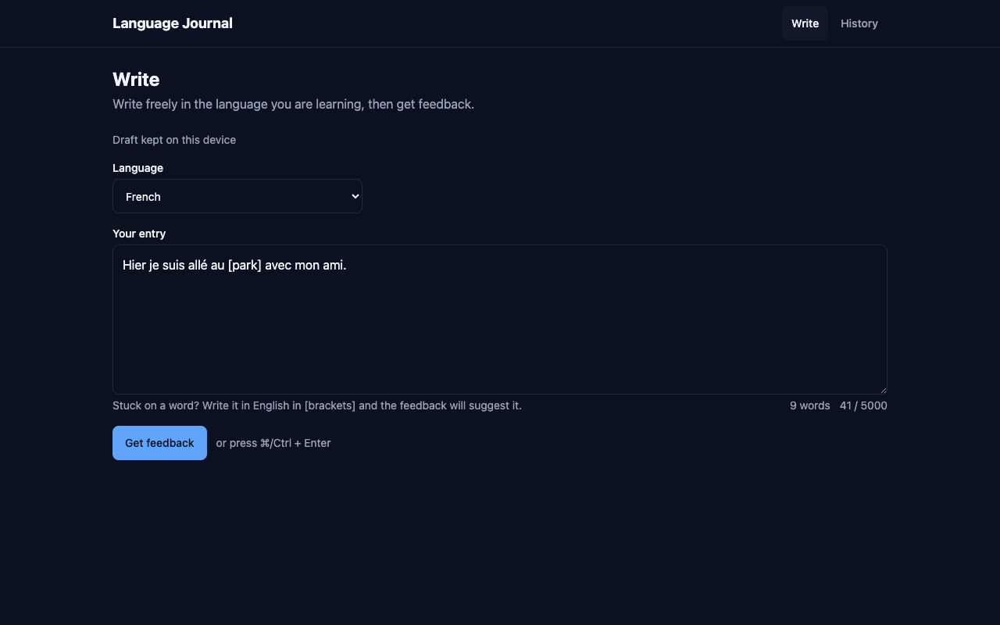
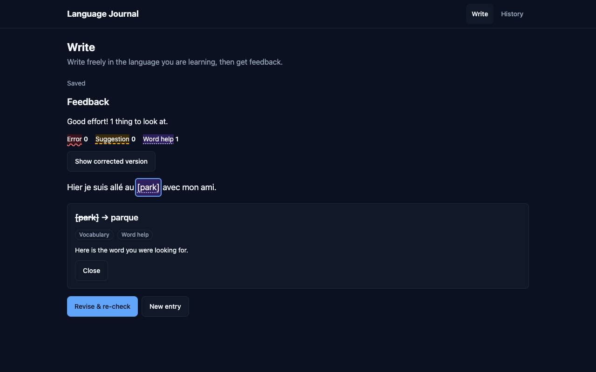
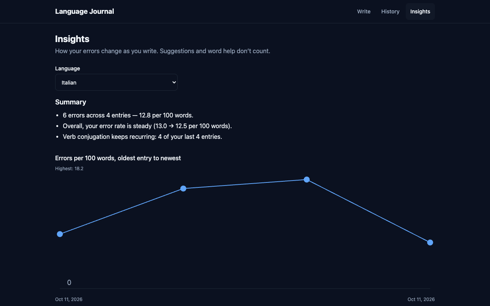
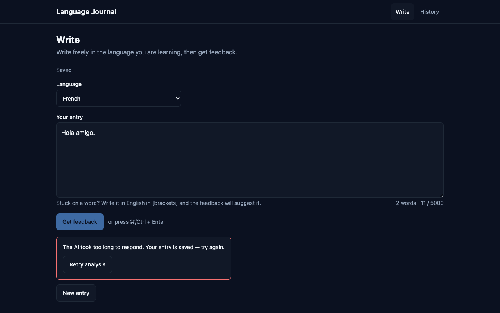
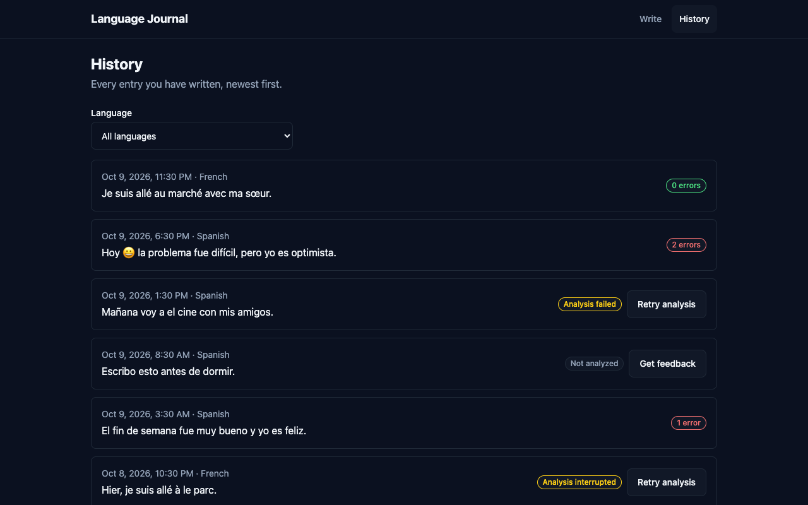
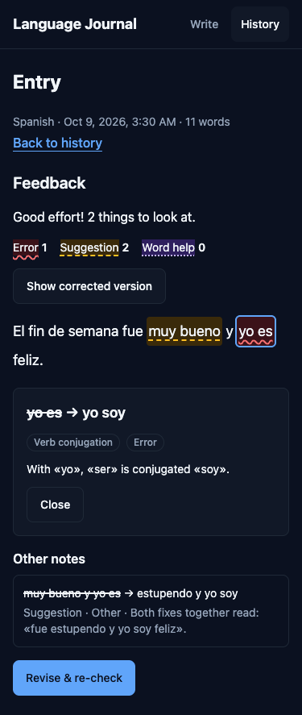

# Language Journal

Write a short journal entry in the language you are learning, get feedback on it, revise it, and watch which
mistakes fade over time. Single user, five languages (es, fr, de, it, pt), feedback from Claude — or a
deterministic demo provider when no API key is set.

| Write | Feedback | Insights |
|---|---|---|
|  |  |  |

| Failed analysis (entry kept, retry) | History | Mobile |
|---|---|---|
|  |  |  |

## Quick start

```bash
docker compose up --build        # or: make up
open http://localhost:8080
```

- **No key:** the backend uses the demo provider (`AI_PROVIDER=fake`). It knows a handful of rules — try
  `Hoy tengo la problema y yo es cansado.` or a bracketed word like `Quiero [to travel] mañana.`
- **Claude:** `cp .env.example .env`, set `ANTHROPIC_API_KEY` (and `ANTHROPIC_WORKSPACE_ID` if the key is user- or
  organisation-scoped), then `docker compose up --build` again. The provider switches automatically when a key is set.
- Every variable is optional and documented in `.env.example`.

### Local development

| Command | What it does |
|---|---|
| `make install` | `uv sync` (Python workspace) + `pnpm install` |
| `make db` · `make migrate` | Postgres 16 in Docker · Alembic migrations |
| `make dev-backend` | FastAPI on :8000 with reload |
| `make dev-frontend` | Vite on :5173 against the in-memory MSW API; `VITE_API_MOCKS=off make dev-frontend` uses the real backend |
| `make verify-fast` | lint + types everywhere |
| `make verify` | every CI gate in CI order: hygiene → ruff → import-linter → mypy → pytest → offline eval → migrations check → frontend (types, lint, dead code, Vitest + coverage band, Playwright + axe, Lighthouse) |
| `make e2e-stack` | the full Compose stack with the demo provider + Playwright smoke |
| `make eval` | the eval set against the real model (needs a key) |

## How it works

```
Browser — React 19 SPA (Vite, TanStack Query, ky)
   │  REST/JSON  /api/v1
   ▼
FastAPI ── routes → services → repositories → SQLAlchemy 2 (async) → Postgres 16
   │            └── journal_ai: prompt v1 → Claude (structured output) → parse → retry once → align offsets
   ├── structlog JSON logs with request_id
   ├── Sentry (backend + frontend, only when a DSN is set)
   └── Langfuse traces (only when keys are set; metadata only)
```

**"Get feedback", step by step**

1. `POST /entries` saves the text (201). Writing is never lost, whatever the AI does next.
2. `POST /entries/{id}/analyses` commits a `pending` analysis, then calls the analyzer outside any transaction.
3. The analyzer builds prompt v1, asks Claude for JSON matching an explicit schema, parses defensively, retries
   once on unusable output, and aligns each mistake to code-point offsets in the analysed text.
4. The outcome is stored either way — `succeeded` with mistakes, or `failed` with an `error_code` — and returned
   as 201. A failed AI call is data, not an exception.
5. The UI highlights mistakes in the learner's own words, or shows the failure with "Retry analysis".

Layering is enforced by import-linter: routes never touch the ORM, repositories hold no rules, services depend
on an `Analyzer` protocol, `journal_ai` never imports the backend, and only `journal_ai` touches the provider SDK.

## Product decisions

| Decision | Choice | Why |
|---|---|---|
| Feedback timing | After writing, on request | Live correction interrupts the flow of writing |
| Not knowing a word | Write `[English word]`; feedback fills it in as `vocab_help` | Keeps the learner writing and teaches the word |
| Correction kinds | `error`, `suggestion`, `vocab_help` | Only errors count as progress, so style tips don't inflate "mistakes" |
| Presentation | Inline highlights + detail panel, corrected-text toggle, unplaceable items under "Other notes" | Mistakes shown in the learner's own words; nothing silently dropped |
| Save model | Save first, analyse second; autosaved draft, no Save button | An AI failure never costs the learner their text |
| Revision | "Revise & re-check" edits the entry and creates a new analysis | Encourages self-correction; old analyses stay as history |
| Taxonomy | Fixed 11 categories; unknown → `other` | Free-form categories can't be counted over time |
| Insights summary | Template sentences from computed numbers | Testable and cannot hallucinate |

## API (`/api/v1`)

| Method | Path | Behaviour |
|---|---|---|
| GET | `/health` (unversioned) | Liveness + database ping |
| GET | `/languages` | Supported languages |
| POST | `/entries` | `{language, text}` → 201 entry |
| GET | `/entries?language=&cursor=&limit=` | Cursor page on `(created_at, id)`, default 20, max 50, with latest analysis status and error count |
| GET | `/entries/{id}` | Entry + latest analysis with mistakes |
| PATCH | `/entries/{id}` | `{text}` → updated entry |
| POST | `/entries/{id}/analyses` | Runs analysis synchronously → 201 (`succeeded`, or `failed` + `error_code`) |
| GET | `/entries/{id}/analyses` | Analysis history, newest first |
| GET | `/insights?language=` | Stage 2 payload |

Text is 1–5000 characters after trimming; unsupported language → 422; unknown id → 404. Errors are RFC 7807
`application/problem+json` and carry the `request_id`. `raw_response` and `error_detail` are never returned.

## Data model

- **entries** — `id, language, text, word_count, created_at, updated_at`; index `(language, created_at)`.
- **analyses** — `id, entry_id → entries (cascade), status (pending|succeeded|failed), input_text, corrected_text,
  feedback_summary, model, prompt_version, raw_response, error_code, error_detail, latency_ms, input_tokens,
  output_tokens, retried, dropped_mistakes, created_at, completed_at`; index `(entry_id, created_at)`.
  `input_text` snapshots what was analysed, so offsets stay valid after the entry is edited.
- **mistakes** — `id, analysis_id → analyses (cascade), kind, category, original, correction, explanation,
  start_offset, end_offset (null when unplaceable), position`; indexes `(analysis_id)`, `(category)`.

UUID keys, `timestamptz`, Alembic migrations, Postgres enums for kind/category/status/error code.

## AI pipeline (`ai/journal_ai`)

- **Prompt v1** (`prompts/v1.py`): a tutor for the entry's language; the fixed categories and kinds; brackets →
  `vocab_help`; one-sentence English explanations; one encouraging summary; "never flag correct text". The entry is
  wrapped in `<entry>` delimiters with look-alikes stripped and is treated as data (prompt-injection defence).
  Changing the prompt bumps `PROMPT_VERSION`, which is stored on every analysis.
- **Structured output**: `output_config.format` with an explicit JSON schema, explicit `effort` (default `medium`),
  30 s timeout, one SDK retry, refusals detected from `stop_reason`.
- **Defensive parsing** (provider-agnostic): strip fences and stray prose, validate the top level or fail as
  `invalid_output`; validate each mistake on its own and drop (and count) bad ones; unknown category → `other`.
- **One retry** with the validation error appended; then `invalid_output`. Timeout → `provider_timeout`; API errors
  and refusals → `provider_error`.
- **Alignment**: NFC-normalised text, Unicode code-point offsets (the UI slices with `Array.from`), first
  non-overlapping occurrence so repeated snippets map to distinct places, case/whitespace-insensitive fallback;
  anything unplaceable keeps null offsets and appears under "Other notes".
- **Failures are persisted** with `error_code`, the raw response when there was one, and a sanitised
  `error_detail` (exception class and provider message only — never text that could contain the entry).
- **Tracing** (optional): one Langfuse generation per analysis with model, prompt version, latency, tokens, status,
  failure code and mistake counts. Entry text never goes to Langfuse — the model provider is the only third party
  that sees it. Tracer errors never change an analysis.

## Insights rules (Stage 2)

Pure functions in `backend/app/services/insights/calculations.py`, every threshold a named constant:

- Only `kind = error` counts; only each entry's latest **succeeded** analysis counts, so re-checks never
  double-count and a newer failed attempt never hides earlier feedback.
- Rate = errors per 100 words, pooled per window (Σ errors / Σ words × 100), words counted on the analysed snapshot.
- Entries ordered by `created_at`: `recent` = last ⌈n/2⌉ (max 5), `earlier` = the ⌊n/2⌋ before it (max 5).
- n < 3 → not enough data · n = 3 → totals and recurring only · n ≥ 4 → trends.
- Trend: improving if `recent − earlier ≤ −max(0.5, 0.25 × earlier)`, worsening if `≥` that threshold, else steady.
- Recurring: a category in ≥ 3 of the last 5 entries.
- Summary sentences are templates over these numbers, rounded once in the API so text and chart agree.

## Tech choices

| Choice | Why |
|---|---|
| React 19 + Vite SPA | Three screens, one user, no SEO — SSR would add a server for nothing |
| TypeScript strict | The API contract is typed end to end |
| Tailwind v4 with semantic tokens | One token file controls colour and spacing; lint rejects raw values |
| TanStack Query | The server cache is the single owner of server data; invalidation keeps Insights fresh after an analysis |
| ky | Tiny fetch wrapper with timeouts and typed errors |
| React Router | Three routes with URL-held filters (`?language=`) |
| MSW | One in-memory API for dev, Vitest, Playwright and the Lighthouse build |
| FastAPI + Pydantic v2 | Async, typed request/response models, OpenAPI for free |
| SQLAlchemy 2 async + asyncpg | Explicit queries (`DISTINCT ON`) without hand-written SQL strings |
| Alembic | Reviewed migrations; `alembic check` in CI catches model drift |
| Postgres 16 | Real enums and `timestamptz`; tests run on the same engine as production |
| `anthropic` SDK directly | Structured outputs and effort are first-class; a framework would hide the failure modes we handle |
| uv workspace | One lockfile for `journal_ai` and the backend; fast, reproducible installs |
| pnpm | Strict, fast installs for the frontend |
| structlog | JSON logs with `request_id` bound per request |
| Sentry | Error reporting with scrubbing, off without a DSN |
| Langfuse | Per-call latency/tokens/failure view of the model, off without keys |
| pytest, Vitest + Testing Library, Playwright + axe | The right tool per layer of the pyramid (below) |
| ruff, mypy strict, ESLint, import-linter | Rules enforced by tools, not by memory |
| Docker Compose | One command runs Postgres, migrations, backend and the nginx-served frontend |
| GitHub Actions | CI per package in parallel; CD to GHCR after green CI |

## Testing

| Layer | Tool | What it proves | Count |
|---|---|---|---|
| AI package | pytest + `FakeProvider` | parsing table, alignment (accents, repeats, fallback, not found), retry → success/failure, timeout, refusal, tracing never leaks text | 166 |
| Backend | pytest on real Postgres (per-test rollback) | create → analyse → store → retrieve, failed analyses persisted, re-analysis, 404/422, paging, insights rules and the latest-succeeded query | 175 (coverage 99%, floor 85%) |
| Frontend units/components | Vitest + Testing Library + MSW | every screen's loading/empty/error/ready states, highlights, keyboard, revise loop, insights rules ported for the mock | 279 (coverage band 65–85%) |
| Frontend e2e | Playwright + axe, 1280 px and 375 px | user journeys with zero axe violations and pointer cursors on every button | 40 |
| Full stack | Compose + demo provider + Playwright | write → feedback → history → insights through nginx, FastAPI and Postgres | 6 |
| Performance/a11y | Lighthouse (median of 3) | desktop 100 in every category, mobile performance ≥ 90 | desktop 100, mobile 95 |

Tests never use SQLite and never call a real model; the real model is measured by the eval set instead.

## Evals (`ai/evals`, `make eval`)

36 labelled entries: 15 with mistakes and 3 clean per language for Spanish and French, validated by a schema test
(every label must occur in its text as whole words). Metrics: recall of expected mistakes, category accuracy among
caught mistakes, false-positive rate on clean entries, p50 latency. Where the taxonomy genuinely overlaps
(contractions like `a el`, subject–verb number, the French auxiliary, `Est-ce que`) a label accepts either category.

| Run | Cases | Recall | Category accuracy | False positives | p50 latency |
|---|---|---|---|---|---|
| prompt v1, `claude-opus-5-5`, effort medium, first 14-case set | 14 | 91% | 90% | 0% | 3.6 s |
| prompt v1, `claude-opus-5-5`, effort medium (default), current set | 36 | 97% | 100% | 0% | 2.6 s |
| prompt v1, `claude-opus-5-5`, effort low, current set | 36 | 97% | 100% | 0% | 2.6 s |

Low effort scores the same on this set, so it is a viable cost lever; medium stays the default for headroom on longer entries. `make eval args="--limit 6"` samples both languages;
`make eval-fake` runs the harness offline (CI does too).

## Observability and privacy

- **Logs**: structlog, JSON in containers. Middleware binds a `request_id` (honours a safe incoming `X-Request-ID`
  and echoes it) and logs method, path, status and duration. Each analysis logs ids, model, prompt version,
  latency, tokens, kept/dropped mistakes, retried and status — never entry text.
- **Sentry** (only with a DSN): release = git SHA, `request_id` tag, `send_default_pii=False`, request bodies
  scrubbed, frame locals off, SQL parameters hidden; `invalid_output` is a warning. Frontend Sentry is lazy-loaded,
  DOM breadcrumbs off (aria-labels can contain entry text), every data-collection category off.
- **Langfuse** (only with all three keys): metadata-only traces, as above.
- Rule enforced in review: entry text goes to the database and the model provider, nowhere else.

## Repo conventions

Standards are enforced by configuration so contributors and tooling follow the same rules.

- **`CLAUDE.md` files**: root (commands, layering, comment policy, privacy rules, "never" list) plus `frontend/`,
  `backend/` and `ai/` files with package-specific rules.
- **Path-scoped rules** (`.claude/rules/`): backend layering, AI parsing, Python tests, components, state,
  styling, frontend tests; each applies only to matching paths.
- **Role definitions** (`.claude/agents/`): `test-writer` (failing tests before implementation), `reviewer`
  (read-only review of a phase against spec, plan and rules) and `ui-qa` (browser checks per acceptance
  criterion at desktop and 375 px, with screenshots in `docs/qa/`).
- **Hooks** (`.claude/settings.json`): `guard-secrets` blocks any tool call that touches a real env file;
  `post-edit` runs ruff/mypy or ESLint/tsc on the edited file; `stop-gate` refuses "done" while
  `make verify-fast` is red.
- **Skills** (`.claude/skills/`): design-system, component, testing and api-integration checklists.
- **Planning**: design spec in `docs/superpowers/specs/`, one plan per phase in `docs/superpowers/plans/` (the
  index lists status).
- **Gates**: `make verify` mirrors CI; `scripts/check-hygiene.sh` fails on leaked keys or private wording.

## CI/CD

`.github/workflows/ci.yml` runs `hygiene`, `ai`, `backend` (with a Postgres service), `frontend` and `e2e-stack`
jobs; `cd.yml` runs after a green CI on `main`, pushes `ghcr.io/<owner>/journal-backend:<sha>` and
`journal-frontend:<sha>`, and creates a Sentry release when `SENTRY_AUTH_TOKEN` is configured.

Both workflow files exist locally but are not pushed yet: the token used for this repo lacks GitHub's `workflow`
scope. To enable them: `gh auth refresh -s workflow`, remove `.github/workflows/` from `.git/info/exclude`, commit
the two files, and set the optional `SENTRY_AUTH_TOKEN` and `HYGIENE_TERMS` secrets and the
`SENTRY_ORG`/`SENTRY_PROJECT`/`VITE_SENTRY_DSN` variables. Until then, `make verify` + `make e2e-stack` run the
same gates locally.

## Deliberately left out

| Omission | Why |
|---|---|
| Auth / multiple users | Single-learner slice; a `user_id` column and a row filter are mechanical later |
| Deleting entries | Not needed to show the learning loop; history is the point |
| Live grammar checking | Interrupts writing — the friction the product avoids |
| Autocomplete | Writes for the learner instead of with them |
| Severity scores | Unreliable from a model and not actionable; categories are |
| Background job queue | One user, ~4 s analyses; synchronous with a timeout is simpler (scaling path below) |
| Streaming responses | Feedback is shown as a whole annotated text; partial JSON adds complexity for no UX gain |
| Vector DB / embeddings | Nothing to retrieve; insights are counts |
| LangChain / LangGraph | One structured call with one retry; a framework would hide the failure handling |
| GraphQL | Nine REST endpoints with stable shapes |
| Deployment target | Images are built and pushed; choosing a host is outside the slice |

## Scaling path

- **Queue**: `analyses.status` already models `pending/succeeded/failed`. Moving to arq + Redis changes only the
  trigger: `POST …/analyses` returns 202 with the pending row, a worker runs the same `Analyzer`, the UI polls
  `GET /entries/{id}/analyses` (it already treats a pending row without a request in flight as retryable).
- **Stale pending rows**: a periodic sweeper marks old pending analyses failed.
- **Insights**: one query per request is fine for thousands of entries; beyond that, store per-analysis error
  counts at write time.
- **Users**: `user_id` on entries, scoped repositories, auth at the API edge.

## Known limitations

- Analysis is synchronous: the request waits for the model (30 s timeout, one SDK retry, one parse retry);
  nginx allows 120 s. A cancelled request can leave one `pending` row, which the UI offers to retry.
- The demo provider knows only a few rules; real feedback needs a key.
- The eval set is small (36 cases, two languages) and measures recall against single labelled spans.
- Langfuse traces are metadata-only by design, so prompts cannot be replayed from Langfuse; `raw_response` in the
  database is the debugging record.
- The nginx image runs its master process as root and the frontend container has no healthcheck.
