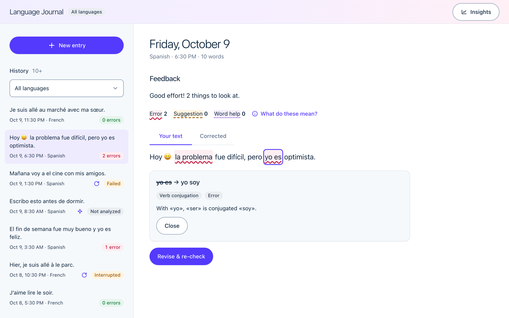
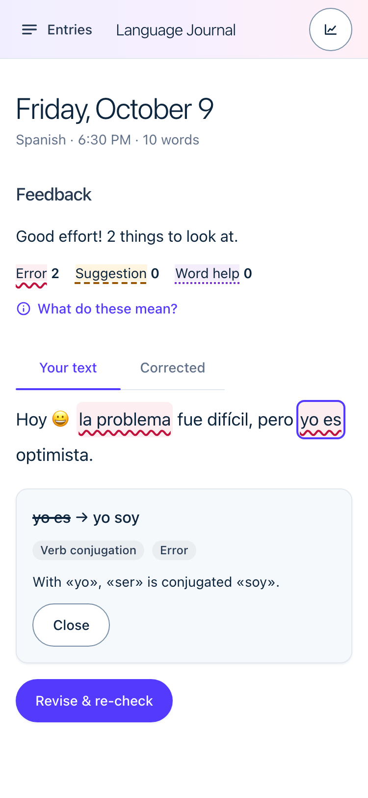
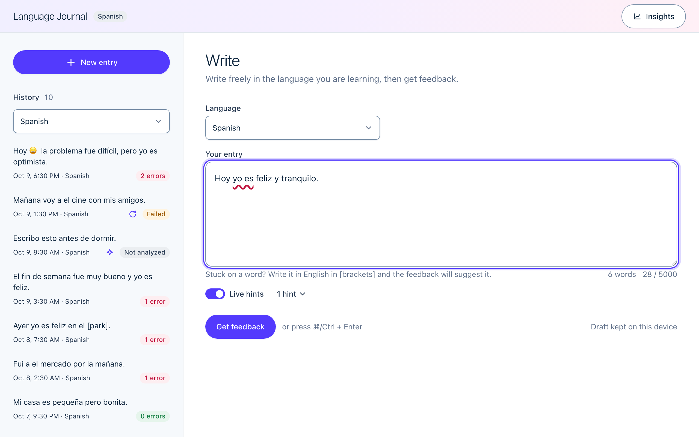
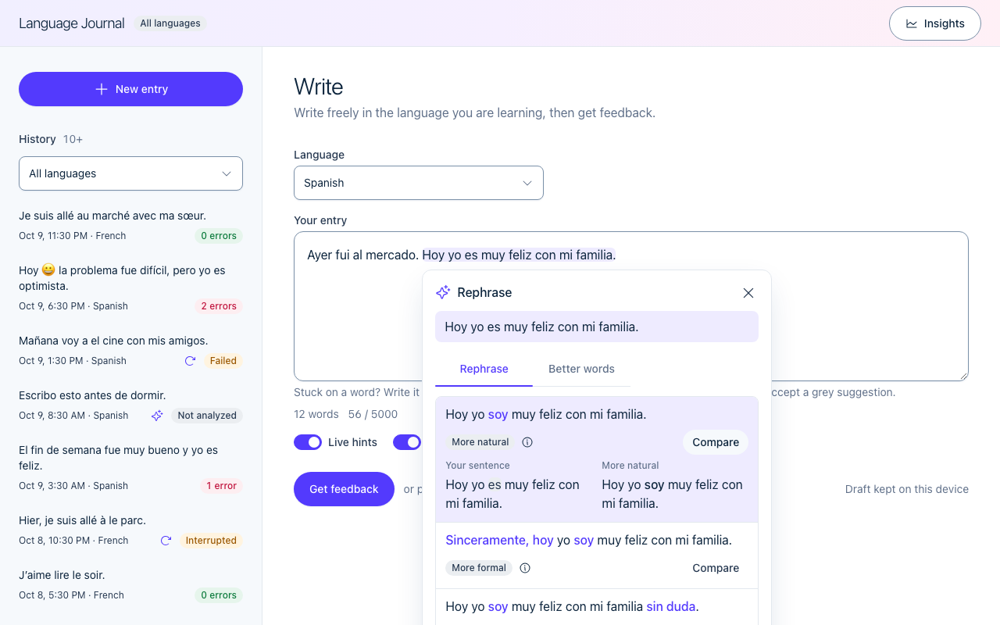
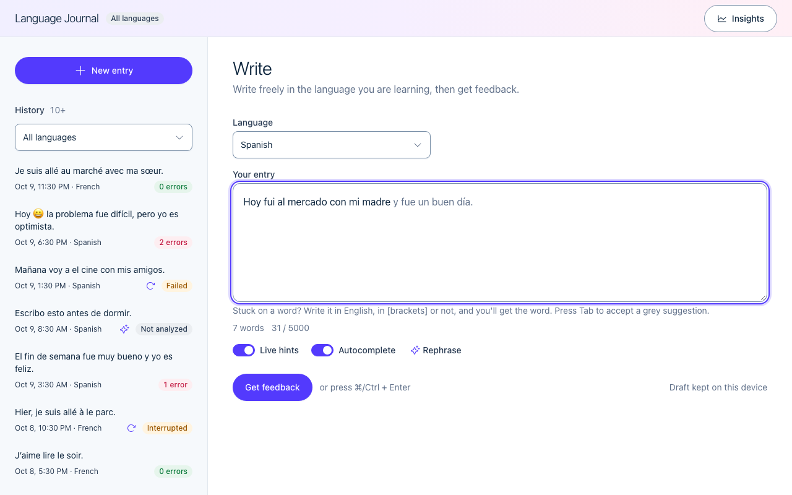
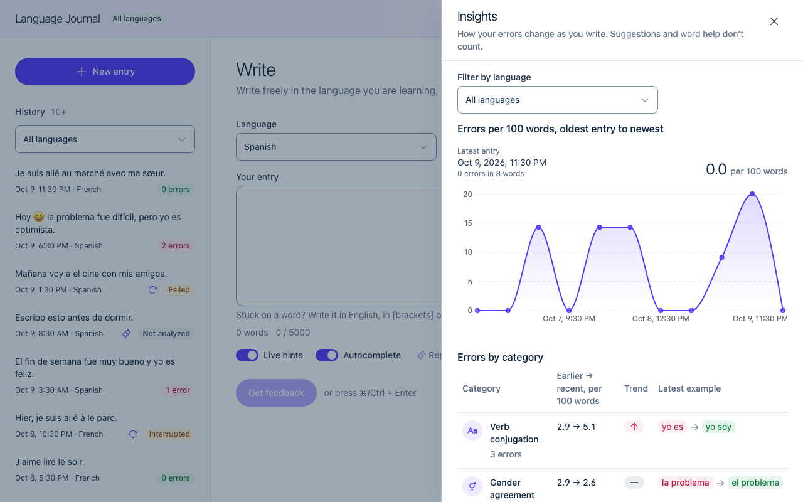

# Language Journal

Write a short journal entry in the language you are learning, get feedback on it, revise it, and watch which
mistakes fade over time. Single user, five languages (es, fr, de, it, pt), feedback from Claude — or a
deterministic demo provider when no API key is set.

| Workspace (desktop) | Workspace (phone) |
|---|---|
|  |  |

| Live hints while writing |
|---|
|  |

| Rephrase and compare | Autocomplete (Tab to accept) | Insights |
|---|---|---|
|  |  |  |

## Quick start

```bash
docker compose up --build        # or: make up
open http://localhost:8080
```

- **No key:** the backend uses the demo provider (`AI_PROVIDER=fake`). It knows a handful of rules — try
  `Hoy tengo la problema y yo es cansado.` or a bracketed word like `Quiero [to travel] mañana.`
  Rephrase and autocomplete answer with scripted demo text, so every feature can be tried without a key.
- **Claude:** `cp .env.example .env`, set `ANTHROPIC_API_KEY` (and `ANTHROPIC_WORKSPACE_ID` if the key is user- or
  organisation-scoped), then `docker compose up --build` again. The provider switches automatically when a key is set.
- Every variable is optional and documented in `.env.example`.

### Local development

Needs Docker with Compose v2, Python 3.13 with [uv](https://docs.astral.sh/uv/), Node 24 and pnpm 10
(`corepack enable`). With an API key configured, `make dev-backend` uses Claude; without one it uses the demo provider.

| Command | What it does |
|---|---|
| `make install` | `uv sync` (Python workspace) + `pnpm install` |
| `make db` · `make migrate` | Postgres 16 in Docker · Alembic migrations |
| `make dev-backend` | FastAPI on :8000 with reload |
| `make dev-frontend` | Vite on :5173 against the in-memory MSW API; `VITE_API_MOCKS=off make dev-frontend` uses the real backend |
| `make verify-fast` | lint + types everywhere |

### Running tests

| Command | What it runs |
|---|---|
| `make test` | AI package and backend tests (pytest); the backend tests need `make db` |
| `make test-ai` · `make test-backend` | one package at a time (the backend run enforces 85% coverage) |
| `pnpm -C frontend test` | frontend unit and component tests (Vitest) |
| `pnpm -C frontend e2e` | browser journeys with accessibility checks (Playwright + axe, desktop and phone) |
| `make e2e-stack` | the full Compose stack with the demo provider + Playwright smoke |
| `make verify` | every quality gate in order: hygiene → ruff → import-linter → mypy → pytest → offline eval → migrations check → frontend (types, lint, dead code, Vitest + coverage band, Playwright + axe, Lighthouse) |
| `make eval` | the eval set against the real model (needs a key) |

## Correction approach

**What it gives.** On "Get feedback", each mistake comes back with a kind (`error`, `suggestion` or `vocab_help`),
one of 11 fixed categories, the correction and a one-sentence English explanation, plus the fully corrected text
and a short encouraging summary. While writing, the same feedback arrives as quiet underlines (live hints), and on
request as rewritten versions of a sentence, better words and a short autocomplete.

**Why it helps a learner.** Mistakes are shown inside the learner's own sentences, where they were made, and each
explanation teaches the rule rather than only the fix. Fixed categories make mistakes countable, so insights can
show which ones are fading and which keep coming back. Only errors count as progress, so style tips never inflate
the error rate. A word the learner doesn't know can be written in English, with or without `[brackets]`, and comes
back as the word to use, so writing never stops for a dictionary. "Revise & re-check" asks the learner to fix the
text themselves, and every rewritten version says why it reads better.

**How the UI supports writing and review.** One screen: write, get feedback, revise and open past entries without
changing page. The draft autosaves and the entry is saved before it is analysed, so an AI failure never loses text.
Hints never take focus, and every accepted change can be undone with Cmd/Ctrl+Z. The history sidebar opens any
entry with its highlighted corrections and keeps every earlier analysis; insights open over the workspace.

**How AI output is handled.** The model answers in JSON against an explicit schema; the parser validates each
mistake on its own, retries once on unusable output, and aligns every mistake to character offsets in the analysed
text. The result is stored either way (`succeeded` with mistakes, or `failed` with an error code) and surfaced as
highlights, a detail panel and a corrected-text tab, or as "Retry analysis". Details: "How it works", "AI pipeline".

**What was left out.** Auth and multiple users (a single learner, as the brief allows), deleting entries, storing
rewrites and accepted suggestions (insights measure what the learner wrote), severity scores (categories are more
reliable and actionable), a job queue (analyses take about 4 s; see "Scaling path") and a hosted deployment
(Docker Compose runs the whole stack with one command).

## How it works

```
Browser — React 19 SPA (Vite, TanStack Query, ky)
   │  REST/JSON  /api/v1
   ▼
FastAPI ── routes → services → repositories → SQLAlchemy 2 (async) → Postgres 16
   │            └── journal_ai: prompt v2 → Claude (structured output) → parse → retry once → align offsets
   │            └── POST /check: the same Analyzer on a fast model, one attempt, untraced, nothing stored
   │            └── POST /rephrase, POST /complete: WritingAssist on the same fast model, untraced, nothing stored
   ├── structlog JSON logs with request_id
   ├── Sentry (backend + frontend, only when a DSN is set)
   └── Langfuse traces (only when keys are set; metadata only)
```

**"Get feedback", step by step**

1. `POST /entries` saves the text (201). Writing is never lost, whatever the AI does next.
2. `POST /entries/{id}/analyses` commits a `pending` analysis, then calls the analyzer outside any transaction.
3. The analyzer builds prompt v2, asks Claude for JSON matching an explicit schema, parses defensively, retries
   once on unusable output, and aligns each mistake to code-point offsets in the analysed text.
4. The outcome is stored either way — `succeeded` with mistakes, or `failed` with an `error_code` — and returned
   as 201. A failed AI call is data, not an exception.
5. The UI highlights mistakes in the learner's own words, or shows the failure with "Retry analysis".

**Live hints** (`POST /check`) are a separate, disposable path: the composer sends the text after a pause, the
fast model returns mistakes with offsets, and nothing is stored or traced. Details below. **Rephrase** and
**autocomplete** (`POST /rephrase`, `POST /complete`) are disposable in the same way; see "Writing assist".

Layering is enforced by import-linter: routes never touch the ORM, repositories hold no rules, services depend
on an `Analyzer` protocol, `journal_ai` never imports the backend, and only `journal_ai` touches the provider SDK.

## The workspace (frontend)

One screen, no page changes. The sidebar lists entries (language filter, "Load more", a progress sparkline);
the main column is either the composer or the selected entry; insights open as a sheet over both. The URL holds
the state: `?entry=<id>`, `?insights=1`, `?language=es`, so links are shareable and Back works; old links
(`/entries/<id>`, `/insights`) redirect. On phones the sidebar is a left sheet and insights a bottom sheet.
Bracketed English words become chips while typing (a mirrored layer behind a native textarea, so IME, undo and
screen readers are untouched). The theme is light only. Visual language: [`DESIGN.md`](DESIGN.md); motion
primitives (sheet, tabs, toast) are adapted by hand from SmoothUI (MIT).

### Live hints

After a 1.2 s pause (at least 3 words, never mid-IME-composition) the composer asks `POST /check` and draws quiet
underlines under likely mistakes, in the same colours and styles as saved feedback. Nothing pops up by itself and
focus never leaves the text:

- Click an underline to open a small popover under the word (it flips above near the bottom) with the correction
  and a one-line explanation. **Accept** replaces the span through the textarea's editing API, so Cmd/Ctrl+Z undoes
  it; **Dismiss** hides every occurrence of that exact hint (same words, same correction) for the composer session.
  Typing, moving the caret or Esc closes the popover; Tab reaches its buttons.
- An "n hints" disclosure under the editor lists the same hints with Accept and Dismiss per item. This is the
  keyboard and screen-reader path; the count is announced politely and throttled.
- A "Live hints" switch turns the whole feature off (remembered locally, default on).
- Hints keep their place while you type: each server span is carried across the edit made since the check, and a
  span the edit touched is dropped, never moved. Case-only corrections show as suggestions, not errors. If a newer
  check fails (503), the last good hints stay; an unavailable check is retried once after the debounce.
- Time to hint is the debounce plus the model call: about 1.2 s + 1.9 s, roughly 3.1 s at p50 on eval-sized entries.
  Demo mode (`AI_PROVIDER=fake`) serves scripted hints, so the feature works without a key.

Why it is in the product, and how it affects insights, is under "Product decisions" and "Known limitations".

### Writing assist

Three more helpers sit on top of live hints. All three are disposable like hints: the text goes to the live model
and the answer comes back to the screen, and **nothing is stored, traced or counted in insights**. The saved
analysis stays the only record of what the learner wrote.

**Rephrase and better words** (`POST /rephrase`). With the caret in a sentence, the **Rephrase** button under the
editor (or **Alt/Option+R**; ⌘⇧R is the browser's hard reload) opens a card: a non-modal card under the sentence
on desktop, a bottom sheet on a phone. Selecting 3 or more words also shows a small pill that rephrases exactly
the selection (mouse only, never on touch).

- *Rephrase tab*: up to three versions of the sentence, each with a tone badge (more natural, more formal, more
  casual, simpler) and an info toggletip with a one-line English reason. Words that changed from the original are
  indigo, the rest is plain, so the difference is visible without reading both. **Compare** shows the original and
  the version in two columns (stacked on a phone). Picking a version replaces the sentence through the textarea's
  editing API, so Cmd/Ctrl+Z undoes it. If the sentence changed since the call, nothing is replaced and the card says so.
- *Better words tab*: up to four words from the sentence, each with up to three alternatives and a note on how the
  nuance differs. Clicking a chip replaces the word, undoably.
- On a saved entry the same card is read-only: read, compare and **Copy** a version; the entry is not edited.
- The client computes the word diff (a word-level LCS), so the model only returns text, which is easier to validate.

**Autocomplete** (`POST /complete`). After a 700 ms pause with the caret at the very end of the text, at least three
words, no selection and no IME composition, a grey ghost of at most 8 words appears after the caret. **Tab**
accepts it (undoable); Esc dismisses it before anything else; typing the ghost's own letters consumes it and any
other typing clears it. Tab is never trapped: with no ghost it moves focus as usual. A polite live region announces
each suggestion once, and on a touch device an **Accept** button replaces the Tab key. It has its **own switch**,
separate from Live hints, on by default and remembered across reloads.

**Word help without brackets.** Prompt v2 treats a word in another language, such as `Ayer fui al market`, like a
`[bracketed]` word: live hints and saved feedback both offer `mercado` as word help, accepted through the same
undoable replacement. Names and loanwords used natively (Michael) are not flagged; the eval has cases for both.

**Why this helps a learner.** The aim is to teach, not to write for the learner. Every rephrased version says
*why* it is better and marks what changed, so reading becomes a comparison with the learner's own sentence. Better
words teach nuance, which a plain translation hides. Autocomplete is the riskiest of the three because it can
replace thinking, so it is short, appears only at a pause at the end of the text, needs a deliberate Tab and has
its own off switch. Rephrase happens only on request.

**What it costs.** Both calls use the live model (`AI_LIVE_MODEL`, default `claude-haiku-5-5`, effort low, one
attempt, no SDK retries). Rephrase is one call per click. Autocomplete is one call per pause: roughly 15 to 35
Haiku calls per minute of continuous typing, each sending the whole entry, and a call the client cancels is still
billed. Each endpoint has its own `Semaphore(2)` per process, shared by all users, and answers 503 when full. The
card and the ghost show a loading or an inline "assist unavailable" state with Retry; writing and feedback keep
working. Keyboard: Tab is never trapped, Esc dismisses the ghost before the card.

**Insights polish.** The sheet opens on an animated error-rate chart (recharts, in the lazy insights chunk, with a
tooltip, a text readout for screen readers and no motion under reduced motion), then the category table: a Phosphor
icon per category, red and green arrows for the trend (the words stay for screen readers), and each correction as a
red original pill and a green correction pill that never wrap.

## Product decisions

| Decision | Choice | Why |
|---|---|---|
| Feedback timing | Quiet live hints while writing; full saved feedback on request | The interruption to avoid is modal correction and stolen focus. These hints are quiet underlines that never take focus, accept is opt-in per hint, and a switch turns them off. The live model scores 0% false positives on the eval's clean entries (below), which is the number that decides whether underlines are friction. The saved analysis stays the single source of history and insights |
| Hints and insights | Insights measure the submitted text | Accepting a hint fixes the mistake before the counted analysis runs, so a learner who accepts every underline sees their measured error rate fall. That is deliberate for this slice: accept is per hint, the switch turns hints off, and the saved analysis still reflects what the learner chose to submit. Follow-up: record accepted-hint categories (no text) and show "caught while writing" next to the rate |
| Not knowing a word | Write `[English word]` or just the English word; feedback fills it in as `vocab_help` | Keeps the learner writing and teaches the word; brackets are optional since prompt v2, and names and loanwords are never flagged |
| Rephrase | On request; three versions with a reason each, changed words marked, apply undoable, nothing stored | A rewrite teaches only when the learner sees what changed and why. Storing rewrites would make the app a ghostwriter's archive, and insights measure what the learner wrote |
| Autocomplete | Opt-out switch of its own, ghost at the end of the text after a pause, Tab to accept | Short, deliberate and separately switchable answers the objection that it writes for the learner; on by default because a switch nobody finds is not consent |
| Live assist vs feedback after writing | Quiet help while writing (hints, rephrase, autocomplete), full feedback on request | The brief asked for feedback after writing; hints already moved past it, and rephrase and ghost text follow the same rule: never take focus, never apply anything without the learner's key press |
| Correction kinds | `error`, `suggestion`, `vocab_help` | Only errors count as progress, so style tips don't inflate "mistakes" |
| Presentation | Inline highlights + detail panel, corrected-text toggle, unplaceable items under "Other notes" | Mistakes shown in the learner's own words; nothing silently dropped |
| Save model | Save first, analyse second; autosaved draft, no Save button | An AI failure never costs the learner their text |
| Revision | "Revise & re-check" edits the entry and creates a new analysis | Encourages self-correction; old analyses stay as history |
| Taxonomy | Fixed 11 categories; unknown → `other` | Free-form categories can't be counted over time |
| Insights | The chart and category table carry the numbers; template sentences appear only when there is not enough data | The summary bullets repeated the chart. The numbers are deterministic, testable and cannot hallucinate |

## API (`/api/v1`)

| Method | Path | Behaviour |
|---|---|---|
| GET | `/health` (unversioned) | Liveness + database ping |
| GET | `/languages` | Supported languages |
| POST | `/entries` | `{language, text}` → 201 entry |
| GET | `/entries?language=&cursor=&limit=` | Cursor page on `(created_at, id)`, default 20, max 50, with latest analysis status and error count |
| GET | `/entries/{id}` | Entry + latest analysis with mistakes |
| PATCH | `/entries/{id}` | `{text}` → updated entry |
| POST | `/entries/{id}/analyses` | Runs analysis synchronously → 201 (`succeeded`, or `failed` + `error_code`) |
| GET | `/entries/{id}/analyses` | Analysis history, newest first |
| POST | `/check` | `{language, text}` → 200 `{analyzed_text, hints}` from the fast live model; nothing stored; 503 when unavailable or busy |
| POST | `/rephrase` | `{language, text, start, end}` → 200 `{sentence, versions, vocabulary}` from the live model; `text` is returned normalised (or 422), offsets are code points, vocabulary offsets index the returned sentence; nothing stored; 503 when unavailable or busy |
| POST | `/complete` | `{language, text}` → 200 `{completion}` (at most 8 words, `""` allowed; `text` is not trimmed, so a trailing space survives); nothing stored; 503 when unavailable or busy |
| GET | `/insights?language=` | Stage 2 payload |

Twelve endpoints in all. Text is 1–5000 characters after trimming (`/rephrase` spans are 3+ words, at most 500 code points); unsupported language → 422; unknown id → 404. Errors are RFC 7807
`application/problem+json` and carry the `request_id`. `raw_response` and `error_detail` are never returned.

## Data model

- **entries** — `id, language, text, word_count, created_at, updated_at`; index `(language, created_at)`.
- **analyses** — `id, entry_id → entries (cascade), status (pending|succeeded|failed), input_text, corrected_text,
  feedback_summary, model, prompt_version, raw_response, error_code, error_detail, latency_ms, input_tokens,
  output_tokens, retried, dropped_mistakes, created_at, completed_at`; index `(entry_id, created_at)`.
  `input_text` snapshots what was analysed, so offsets stay valid after the entry is edited.
- **mistakes** — `id, analysis_id → analyses (cascade), kind, category, original, correction, explanation,
  start_offset, end_offset (null when unplaceable), position`; indexes `(analysis_id)`, `(category)`.

`prompt_version` is stored as `v2` on new analyses. Rephrase and complete add no tables or columns.

UUID keys, `timestamptz`, Alembic migrations, Postgres enums for kind/category/status/error code.

## AI pipeline (`ai/journal_ai`)

- **Prompt v2** (`prompts/v2.py`, v1 → v2 in P8): a tutor for the entry's language; the fixed categories and kinds; brackets, or a word in another language, →
  `vocab_help` (names and loanwords excluded); one-sentence English explanations; one encouraging summary; "never flag correct text". The entry is
  wrapped in `<entry>` delimiters with look-alikes stripped and is treated as data (prompt-injection defence).
  Changing the prompt bumps `PROMPT_VERSION`, which is stored on every analysis.
- **Structured output**: `output_config.format` with an explicit JSON schema, explicit `effort` (default `medium`),
  30 s timeout, one SDK retry, refusals detected from `stop_reason`.
- **Live variant** (`POST /check`): the same `Analyzer` and schema on `AI_LIVE_MODEL` (default `claude-haiku-5-5`),
  effort low, 8 s timeout, one attempt and no SDK retries, no tracer. The server answers without calling the model
  for fewer than 3 words and caps concurrent checks at 2 per process, refusing (503) rather than queueing.
- **Writing assist** (`POST /rephrase`, `POST /complete`): one `WritingAssist` provider with two prompts, two JSON
  schemas and two parsers, built like the live analyzer (same model, effort and timeout, one attempt). Rephrase
  returns up to three distinct versions plus vocabulary; the parser validates each item on its own, drops a version
  equal to the sentence or a duplicate, drops vocabulary it cannot find in the sentence (offsets are located by the
  parser, never trusted from the model), and no usable version is an `invalid_output`. A completion is cut to one
  line of at most 8 words, with a leading space only when it starts a new word.
  The entry and the sentence are delimited and treated as data, as in the analysis prompt. The demo provider answers
  both with scripted text, pinned by a shared fixture the mock API also reads.
- **Defensive parsing** (provider-agnostic): strip fences and stray prose, validate the top level or fail as
  `invalid_output`; validate each mistake on its own and drop (and count) bad ones; unknown category → `other`.
- **One retry** with the validation error appended; then `invalid_output`. Timeout → `provider_timeout`; API errors
  and refusals → `provider_error`.
- **Alignment**: NFC-normalised text, Unicode code-point offsets (the UI slices with `Array.from`), first
  non-overlapping occurrence so repeated snippets map to distinct places, case/whitespace-insensitive fallback;
  anything unplaceable keeps null offsets and appears under "Other notes".
- **Failures are persisted** with `error_code`, the raw response when there was one, and a sanitised
  `error_detail` (exception class and provider message only — never text that could contain the entry).
- **Tracing** (optional): one Langfuse generation per analysis with model, prompt version, latency, tokens, status,
  failure code and mistake counts. Entry text never goes to Langfuse — the model provider is the only third party
  that sees it. Tracer errors never change an analysis.

## Insights rules (Stage 2)

Pure functions in `backend/app/services/insights/calculations.py`, every threshold a named constant:

- Only `kind = error` counts; only each entry's latest **succeeded** analysis counts, so re-checks never
  double-count and a newer failed attempt never hides earlier feedback.
- Rate = errors per 100 words, pooled per window (Σ errors / Σ words × 100), words counted on the analysed snapshot.
- Entries ordered by `created_at`: `recent` = last ⌈n/2⌉ (max 5), `earlier` = the ⌊n/2⌋ before it (max 5).
- n < 3 → not enough data · n = 3 → totals and recurring only · n ≥ 4 → trends.
- Trend: improving if `recent − earlier ≤ −max(0.5, 0.25 × earlier)`, worsening if `≥` that threshold, else steady.
- Recurring: a category in ≥ 3 of the last 5 entries.
- The API still returns template sentences over these numbers, rounded once; the UI shows them only in the not-enough-data state, because the chart and table carry the numbers.

## Tech choices

| Choice | Why |
|---|---|
| React 19 + Vite SPA | One workspace screen, one user, no SEO — SSR would add a server for nothing |
| TypeScript strict | The API contract is typed end to end |
| Tailwind v4 with semantic tokens | One token file controls colour and spacing; lint rejects raw values |
| TanStack Query | The server cache is the single owner of server data; invalidation keeps Insights fresh after an analysis |
| ky | Tiny fetch wrapper with timeouts and typed errors |
| React Router | URL search params are the workspace state (entry, insights, language); old routes redirect |
| recharts 3.10.1 | The shadcn chart is recharts plus a wrapper: an animated area chart with tooltip and hit-testing without hand-written interpolation. It lives only in the lazy insights chunk, so the writing screen and Lighthouse are untouched; the sidebar sparkline stays hand-drawn |
| react-is 19.3.0 | recharts' peer dependency, needed at runtime and never imported here (listed as ignored in the dead-code check, with that reason) |
| @phosphor-icons/react 2.1.10 | The icon set the table and the assist controls use; per-icon imports keep each icon its own tiny module, never the package barrel |
| motion (LazyMotion + domAnimation) | Sheet, tab and toast motion ported from SmoothUI; ~5 kB up front, features lazy-loaded, off under reduced motion |
| MSW | One in-memory API for dev, Vitest, Playwright and the Lighthouse build |
| FastAPI + Pydantic v2 | Async, typed request/response models, OpenAPI for free |
| SQLAlchemy 2 async + asyncpg | Explicit queries (`DISTINCT ON`) without hand-written SQL strings |
| Alembic | Reviewed migrations; `alembic check` in `make verify` catches model drift |
| Postgres 16 | Real enums and `timestamptz`; tests run on the same engine as production |
| `anthropic` SDK directly | Structured outputs and effort are first-class; a framework would hide the failure modes we handle |
| uv workspace | One lockfile for `journal_ai` and the backend; fast, reproducible installs |
| pnpm | Strict, fast installs for the frontend |
| structlog | JSON logs with `request_id` bound per request |
| Sentry | Error reporting with scrubbing, off without a DSN |
| Fast live model (`claude-haiku-5-5`, effort low) | Underlines need a hint within a few seconds and a zero false-positive rate more than top recall; the saved analysis stays on the stronger model |
| Backdrop layer + native `textarea` for underlines | Hints are drawn behind transparent text, so IME, undo, spellcheck and screen readers are untouched; Accept goes through `execCommand`, so Cmd/Ctrl+Z undoes it |
| Client-side word diff | The model returns only text; a word-level LCS on a sentence of at most 500 characters is instant, deterministic and unit-tested |
| Edit-mapped spans (common prefix/suffix) | A hint moves with the text typed since the check, or is dropped; it is never re-found by string search and misplaced |
| Langfuse | Per-call latency/tokens/failure view of the model, off without keys |
| pytest, Vitest + Testing Library, Playwright + axe | The right tool per layer of the pyramid (below) |
| ruff, mypy strict, ESLint, import-linter | Rules enforced by tools, not by memory |
| Docker Compose | One command runs Postgres, migrations, backend and the nginx-served frontend |

## Testing

| Layer | Tool | What it proves | Count |
|---|---|---|---|
| AI package | pytest + `FakeProvider` | parsing table, alignment (accents, repeats, fallback, not found), retry → success/failure, timeout, refusal, tracing never leaks text, live attempts, the writing-assist parsers, the eval scorer | 229 |
| Backend | pytest on real Postgres (per-test rollback) | create → analyse → store → retrieve, failed analyses persisted, re-analysis, 404/422, paging, insights rules and the latest-succeeded query | 237 (coverage 99%, floor 85%) |
| Frontend units/components | Vitest + Testing Library + MSW | every screen's loading/empty/error/ready states, highlights, keyboard, revise loop, insights rules ported for the mock | 824 (coverage band 65–85%) |
| Frontend e2e | Playwright + axe, 1280 px and 375 px | user journeys with zero axe violations and pointer cursors on every button | 87 |
| Full stack | Compose + demo provider + Playwright | write → feedback → history → insights through nginx, FastAPI and Postgres, including a live-hint accept, a rephrase apply, a Tab-accepted autocomplete and an unbracketed word help (7 specs, run at both widths) | 14 |
| Performance/a11y | Lighthouse (median of 3) | desktop 100 in every category, mobile performance ≥ 90 | desktop 100, mobile 92 |
| Live hints (real model) | `make eval` with `AI_MODEL=claude-haiku-5-5`, prompt v2; time-to-hint from the debounce plus the check | 42-case eval: 0 failed, p50 1.9 s per check; about 3.1 s to a hint |

Tests never use SQLite and never call a real model; the real model is measured by the eval set instead.

## Evals (`ai/evals`, `make eval`)

42 labelled entries (36 on the first set, plus 6: English words inside Spanish and French text, loanwords and names, a cognate), for Spanish and French, validated by a schema test
(every label must occur in its text as whole words). Metrics: recall of expected mistakes, category accuracy among
caught mistakes, false-positive rate on clean entries, p50 latency. Where the taxonomy genuinely overlaps
(contractions like `a el`, subject–verb number, the French auxiliary, `Est-ce que`) a label accepts either category.

| Run | Cases | Recall | Category accuracy | False positives | p50 latency |
|---|---|---|---|---|---|
| prompt v1, `claude-opus-5-5`, effort medium, first 14-case set | 14 | 91% | 90% | 0% | 3.6 s |
| prompt v1, `claude-opus-5-5`, effort medium (default), 36-case set | 36 | 97% | 100% | 0% | 2.6 s |
| prompt v1, `claude-opus-5-5`, effort low, 36-case set | 36 | 97% | 100% | 0% | 2.6 s |
| prompt v1, `claude-haiku-5-5` (the live model), effort low, 36-case set | 36 | 90% | 93% | 0% | 2.1 s |
| prompt v2, `claude-opus-5-5`, effort medium (default), current set | 42 | 97% | 100% | 0% | 2.7 s |
| prompt v2, `claude-haiku-5-5` (the live model), effort low, current set | 42 | 91% | 97% | 0% | 1.9 s |

Prompt v2 keeps recall and false positives where v1 had them while adding the unbracketed foreign-word cases (the loanword, cognate and name cases raise no false positive). Low effort scored the same on the 36-case set, so it is a viable cost lever; medium stays the default for headroom on longer entries. The Haiku rows are the live model: it gives up
six points of recall for a lower latency and cost, and still raises no false positive on a clean entry, which is the
property that makes quiet underlines acceptable. `make eval args="--limit 6"` samples both languages;
`make eval-fake` runs the harness offline (`make verify` does too). Rephrase and autocomplete have no eval: their quality is judged by the learner on screen, and their parsers are covered by unit tests.

## Observability and privacy

- **Logs**: structlog, JSON in containers. Middleware binds a `request_id` (honours a safe incoming `X-Request-ID`
  and echoes it) and logs method, path, status and duration. Each analysis logs ids, model, prompt version,
  latency, tokens, kept/dropped mistakes, retried and status — never entry text. Live checks log language, model, latency, hint count and failure code, never text, and are not
  traced in Langfuse. Rephrase and autocomplete add four events (`rephrase_completed`, `rephrase_crashed`, `completion_completed`, `completion_crashed`) with the language, model, latency, counts and error code or exception class only; both calls are untraced and a refused slot (503) logs nothing.
- **Sentry** (only with a DSN): release = git SHA, `request_id` tag, `send_default_pii=False`, request bodies
  scrubbed, frame locals off, SQL parameters hidden; `invalid_output` is a warning. Frontend Sentry is lazy-loaded,
  DOM breadcrumbs off (aria-labels can contain entry text), every data-collection category off.
- **Langfuse** (only with all three keys): metadata-only traces, as above.
- Rule enforced in review: entry text goes to the database and the model provider, nowhere else.

## Repo conventions

Standards are enforced by configuration so contributors and tooling follow the same rules.

- **`CLAUDE.md` files**: root (commands, layering, comment policy, privacy rules, "never" list) plus `frontend/`,
  `backend/` and `ai/` files with package-specific rules.
- **Path-scoped rules** (`.claude/rules/`): backend layering, AI parsing, Python tests, components, state,
  styling, frontend tests; each applies only to matching paths.
- **Role definitions** (`.claude/agents/`): `test-writer` (failing tests before implementation), `reviewer`
  (read-only review of a phase against spec, plan and rules) and `ui-qa` (browser checks per acceptance
  criterion at desktop and 375 px, with screenshots in `docs/qa/`).
- **Hooks** (`.claude/settings.json`): `guard-secrets` blocks any tool call that touches a real env file;
  `post-edit` runs ruff/mypy or ESLint/tsc on the edited file; `stop-gate` refuses "done" while
  `make verify-fast` is red.
- **Skills** (`.claude/skills/`): design-system, component, testing and api-integration checklists.
- **Planning**: design spec in `docs/superpowers/specs/`, one plan per phase in `docs/superpowers/plans/` (the
  index lists status).
- **Gates**: `make verify` runs every quality gate; `scripts/check-hygiene.sh` fails on leaked keys or private wording.

## Scaling path

- **Queue**: `analyses.status` already models `pending/succeeded/failed`. Moving to arq + Redis changes only the
  trigger: `POST …/analyses` returns 202 with the pending row, a worker runs the same `Analyzer`, the UI polls
  `GET /entries/{id}/analyses` (it already treats a pending row without a request in flight as retryable).
- **Stale pending rows**: a periodic sweeper marks old pending analyses failed.
- **Insights**: one query per request is fine for thousands of entries; beyond that, store per-analysis error
  counts at write time.
- **Users**: `user_id` on entries, scoped repositories, auth at the API edge.

## Known limitations

- Analysis is synchronous: the request waits for the model (30 s timeout, one SDK retry, one parse retry);
  nginx allows 120 s. A cancelled request can leave one `pending` row, which the UI offers to retry.
- The demo provider knows only a few rules; real feedback needs a key.
- The eval set is small (42 cases, two languages) and measures recall against single labelled spans.
- Langfuse traces are metadata-only by design, so prompts cannot be replayed from Langfuse; `raw_response` in the
  database is the debugging record.
- **Live hints and insights:** insights measure the submitted text, so a learner who accepts hints sees their
  measured error rate fall because a model fixed the text. Accepted hints are not recorded yet; the follow-up is to
  store accepted-hint categories (no text) and show "caught while writing" beside the rate.
- **Long entries:** `/check` reuses the full analysis schema and discards `corrected_text` and the summary, so output
  and latency grow with the entry. The 1.9 s p50 is from eval-sized entries; the 8 s timeout (`AI_LIVE_TIMEOUT_SECONDS`)
  means a very long entry can answer 503 and simply gets no hints. A mistakes-only live prompt would fix this.
- **Superseded checks are billed:** a client abort does not cancel the server call. At most 2 run per process; a third
  answers 503, and the composer keeps the last good hints.
- **Hint placement:** Hangul conjoining jamo and rare whitespace can make the server's and the browser's text differ;
  the nearby hints are then dropped, never misplaced. Dismissal is per composer session.
- **Browsers:** the hint popover, the rephrase pill, the ghost text and the textarea inset are verified in Chromium only. Firefox and WebKit popover
  behaviour is untested, and the iOS Safari textarea inset is unverified (no WebKit available).
- **Writing assist scope:** the ghost shows only with the caret at the end of the text; a rephrase covers 3 or more
  words and at most 500 code points; accepted versions, better words and ghosts are not tracked, so, like accepted
  hints, they can lower the measured error rate.
- **Autocomplete cost:** a call per pause that sends the whole entry, and calls the client cancels are still billed
  (about 15 to 35 Haiku calls per minute of typing). The off switch is the lever; a per-client limiter and sending
  only the text before the caret are the follow-ups.
- **Accessibility gap:** the touch Accept button is not in the Tab order (keyboard users have Tab itself).
- **Demo mode:** rephrase and autocomplete answers are scripted, not real writing help.
- **Bundle:** the main chunk is 499 kB (157 kB gzip), under Vite's 500 kB warning by less than 1 kB; the rephrase
  results and recharts are lazy chunks, and the next growth should move more of the card behind them.
- The nginx image runs its master process as root and the frontend container has no healthcheck.
